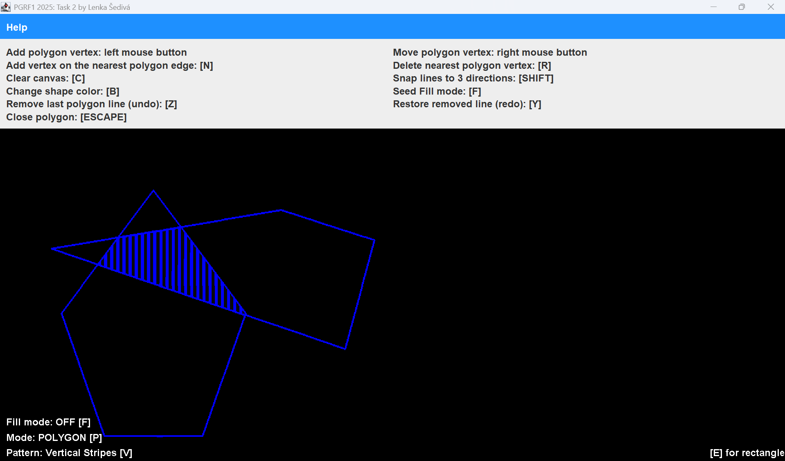

# Raster Polygon Editor

An interactive 2D raster editor for polygons and rectangles written in Java (Swing), created as an assignment for the **PGRF1 2025** course (author: Lenka Šedivá).

The application does not use Java's built-in drawing functions. Line drawing, filling and clipping are implemented with custom algorithms that write directly into a pixel raster (`BufferedImage`).



## Features

- **Polygon drawing**: add vertices with the mouse, rubber-band (dashed, color-gradient) lines to the last and first vertex, close the polygon and draw further objects.
- **Rectangle drawing**: drag the mouse to define the base, then click a third time to set the height. The rectangle can be rotated arbitrarily.
- **Vertex editing**: move a vertex by dragging, insert a new vertex on the nearest edge, delete the nearest vertex.
- **Line snapping**: while holding `Shift`, a line snaps to the horizontal, vertical or diagonal (45°) direction.
- **Undo / Redo** of the most recently added lines.
- **Clipping**: every polygon and rectangle is clipped by a convex pentagon (Sutherland–Hodgman algorithm). The clipped area is filled with a pattern using Scan Line. The pentagon's vertices can be moved too.
- **Seed Fill**: in fill mode, the area is filled using a flood-fill algorithm starting at the clicked point (cross pattern).
- **Fill patterns**: vertical stripes, checkerboard, horizontal stripes, dots (plus a cross pattern for Seed Fill).
- **Shape color selection** via `JColorChooser`.
- When the window is resized, a new raster is created and the scene is redrawn.

## Controls

| Action | Control |
|---|---|
| Add a polygon vertex / rectangle point | left mouse button |
| Move a vertex (polygon and clipping pentagon) | right mouse button + drag |
| Snap line to 3 directions (horizontal / vertical / 45°) | hold `Shift` |
| Add a vertex on the nearest edge (under the cursor) | `N` |
| Delete the nearest vertex | `R` |
| Close the polygon and start a new one | `Esc` |
| Remove the last line (undo) | `Z` |
| Restore the removed line (redo) | `Y` |
| Change color | `B` |
| Toggle Seed Fill mode | `F` |
| Switch fill pattern of the clipped area | `V` |
| Polygon drawing mode | `P` |
| Rectangle drawing mode | `E` |
| Clear the canvas | `C` |

**Rectangle:** press the left mouse button at the starting point, drag to the end of the base and release. Click again to set the height. A single click without dragging does not create a rectangle.

In fill mode (`F`) new shapes cannot be created; clicking inside a shape starts Seed Fill. The current mode, fill state and selected pattern are shown in the bottom-left corner of the canvas.

## Running

You need **Java 21 or newer** (the code uses `List.getLast()` and `switch` expressions). The project has no external dependencies and no build tool.

### Download a prebuilt version

Download `raster-polygon-editor.jar` from the [Releases](https://github.com/lenka-sediva/raster-polygon-editor/releases) page and run it by double-clicking, or from the command line:

```bash
java -jar raster-polygon-editor.jar
```

### Building the JAR

```bash
mkdir -p build/classes
javac --release 21 -encoding UTF-8 -d build/classes $(find src -name "*.java")
jar --create --file build/raster-polygon-editor.jar --main-class App -C build/classes .
```

In PowerShell:

```powershell
javac --release 21 -encoding UTF-8 -d build/classes (Get-ChildItem -Recurse src -Filter *.java).FullName
jar --create --file build/raster-polygon-editor.jar --main-class App -C build/classes .
```

### IntelliJ IDEA

Open the project folder and run the `App` class (`src/App.java`).

### Command line

```bash
javac -d out $(find src -name "*.java")
java -cp out App
```

In PowerShell:

```powershell
javac -d out (Get-ChildItem -Recurse src -Filter *.java).FullName
java -cp out App
```

## Project structure

The project follows the MVC pattern:

```
src/
├── App.java                         entry point, creates the window and Controller2D
├── controller/
│   ├── Controller.java              controller interface
│   ├── Controller2D.java            mouse and keyboard handling, scene state, rendering
│   └── Controller3D.java            empty base for a future 3D part
├── model/
│   ├── objectdata/                  geometric data
│   │   ├── Point2D.java             point, distances
│   │   ├── Line.java                line segment, intersections, point-in-polygon test
│   │   ├── Polygon.java             vertex list, nearest point/edge lookup, orientation
│   │   └── Rectangle.java           rectangle from a base and a height point
│   ├── rasterdata/
│   │   ├── Raster.java              raster interface
│   │   └── RasterBI.java            implementation backed by BufferedImage
│   └── rasterops/
│       ├── clip/SutherlandHodgman.java
│       ├── filler/                  Filler, ScanLine, SeedFill, PatternFill
│       └── rasterizer/              line and polygon rasterization
└── view/
    ├── Window.java                  main window with the help panel
    └── Panel.java                   canvas and status text
```

## Implemented algorithms

### Line rasterization (`model/rasterops/rasterizer`)

| Class | Algorithm | Usage |
|---|---|---|
| `LineRasterizerBresenham` | Bresenham's algorithm with line thickness (capsule effect) | shape edges (via `FilledLineRasterizer`) |
| `DashedLineRasterizer` | DDA, dashed line with a color gradient (`Gradient`) | rubber-band line while drawing |
| `LineRasterizerTrivial` | trivial algorithm (slope-intercept form) | example, not used in the app |
| `LineRasterizerXiaolinWu` | Xiaolin Wu (anti-aliasing) | example, not used in the app |
| `LineRasterizerGraphics` | built-in `Graphics.drawLine` | for comparison |

`PolygonRasterizer` draws a closed polygon as a sequence of lines using the selected rasterizer.

### Filling (`model/rasterops/filler`)

- **`ScanLine`**: scan-line polygon filling. Skips horizontal edges, computes intersections of the edges with the scan line, sorts them (insertion sort) and fills the spans between pairs of intersections. Finally it draws the boundary.
- **`SeedFill`**: flood fill in two variants:
  - bounded **by background color** using a stack (`seedFillStack`),
  - bounded **by boundary color** using a queue (`seedFillQueue`).

  Both variants support 4- and 8-connected filling and either a solid color or a pattern.
- **`PatternFill`**: a functional interface that returns the color for pixel `(x, y)`. Contains the factories `checkerboard`, `horizontalStripes`, `verticalStripes`, `dots` and `cross`.

### Clipping (`model/rasterops/clip`)

- **`SutherlandHodgman`**: clips an arbitrary polygon by a convex clipping polygon. The orientation of the clipping polygon (CW/CCW) is detected automatically (`Polygon.getOrientation`), so vertex order does not matter. The "inside" test uses the dot product with the edge normal (`Line.isInside`).

### Other geometry

- Point-in-polygon test: ray casting (intersection count) in `Line.isPointInsidePolygon`.
- Distance from a point to a line segment (projection onto the segment) in `Point2D.distancePointToLine`.
- Rectangle construction: projection of the third point onto the base normal in `Rectangle.buildVertices`.

## License

This project is licensed under the [MIT License](LICENSE).
